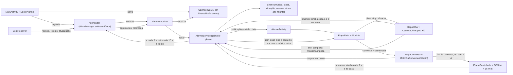

# Alarme Implacável

App Android de despertador feito pra ser impossível de ignorar. Ele toma a tela mesmo com o celular bloqueado e toca a sua música em loop no volume de alarme, inclusive no modo silencioso. Pra desligar, é preciso cumprir uma missão: **dizer "STOP"** e depois **olhar pra câmera de olhos abertos** por 40 minutos, até completar um anel. Depois que tocou, não há outra saída: nem adiar, nem pausa, nem desligar o celular, nem o app cair.

Há também o **"conversa + caminhada"**: depois do STOP, 10 minutos de conversa em inglês com uma IA sobre as notícias do dia, 4 minutos pra se vestir e sair e 16 minutos andando na rua, contados pelo GPS, chova ou faça sol, com ou sem internet. A IA roda no próprio celular, sem internet: o Gemma 4 E2B (Google, licença Apache 2.0) pelo LiteRT-LM (`ModeloLocal`). O arquivo do modelo (2,6 GB) não vai no APK: é copiado uma vez pelo cabo pra pasta do app no celular; sem ele (ou sem a IA por qualquer motivo), esse alarme vai direto pra caminhada. Os dois despertadores são bem diferentes de propósito: **"câmera + frases"** (40 min de câmera, com 5 frases no meio) e **"conversa + caminhada"**. Um motor pela internet (Gemini), pronto, fica guardado fora do app em `reserva/gemini/` como plano B.

- **Linguagem:** Kotlin com Jetpack Compose (Material 3). Câmera com CameraX; rosto e olhos com ML Kit, no próprio aparelho.
- **Testado em:** Galaxy S24 FE (SM-S721B), Android 16 / One UI 8.5.
- **Idioma:** código, nomes e textos em português do Brasil.

## O que o app faz

| Recurso | Como funciona | Onde está |
|---|---|---|
| Toca no minuto exato | `AlarmManager.setAlarmClock`, que ignora a economia de bateria (Doze) | `Agendador.kt` |
| Toma a tela, mesmo bloqueada | Notificação com `fullScreenIntent` abre uma Activity com `showWhenLocked` e `turnScreenOn` | `AlarmeService.kt`, `AlarmeActivity.kt` |
| Música escolhida pelo usuário | Arquivo de áudio do celular (seletor do sistema + permissão persistente); sem escolha, toque de alarme | `Ajustes.kt`, `Sirene.kt` |
| Toca no silencioso e passa pelo Não Perturbe | `MediaPlayer` e vibração com `USAGE_ALARM` | `Sirene.kt` |
| Missão, etapa 1: dizer STOP | Reconhecedor de voz do sistema em loop; a música alterna 5 s alta e 4 s a 25% pra voz ser ouvida | `Ouvinte.kt`, `Missao.kt` |
| Bom dia falado | Depois do STOP, a voz do celular (sintetizador do Android, em inglês, sem internet) diz "Good morning! It's 5:05 AM. It's time for the activity check." no alto-falante; 1,5 s depois, "Activity starting now.", um bipe positivo (`positivo.wav`) e a câmera começa. A cada 10 min completos de câmera, "10 minutes passed." (e 20, 30). Sem voz instalada, só a pausa e o bipe. A voz sai no volume escolhido no bloco "Ajustes" da tela principal (de 10% a 100%; de começo, 30%: `VOLUME_DA_VOZ`, `Ajustes.volumeDaVoz`, `volumeDaVoz`); os sons de aviso (bipe positivo, plim, parabéns), a 40% (`volumeDosAvisos`), mesmo com a subida do volume ainda no começo | `Saudacao.kt`, `AlarmeService.kt` |
| Verificação no meio | Na metade da câmera (20 min; 15 s no teste) o anel para: bipe leve, "Let's verify that you are awake. Repeat the following sentences after me.", e 5 frases motivacionais sorteadas do dia (`Frases.kt`), que a voz fala e a pessoa repete em inglês (`repetiu` aceita sotaque e contrações), com um "plim" a cada acerto. Enquanto ela fala, a tela mostra o que o reconhecedor ouve ("Ouvi: …") e pinta de verde as palavras da frase já ditas (`palavrasDitas`), com um cursor vermelho piscando depois da última certa (de onde continuar); uma pausa no meio não perde o que já foi dito (`Ouvinte` com `juntar`, últimas 20 palavras). Sem responder por 5 s, um apito alto (outro a cada 5 s); em 20 s o anel zera e a música volta. Só conta resposta fala com palavras, e por no máximo 30 s por frase (`PRAZO_FRASE_MS`): uma TV ligada ou resmungar da cama não seguram a verificação. No fim, "Thank you very much for your effort, sir. You reached the middle of the activity." e a câmera continua, mais exigente com os olhos (média acima de 55%). Sem reconhecimento de voz em inglês, ela é pulada | `AlarmeService.kt`, `Missao.kt`, `Frases.kt`, `RegrasMissao.kt` |
| Comemoração no fim | Anel completo: bipe leve (`leve.wav`), "Congratulations, sir! The activity is done. Have a good time getting back to your activities." e um estouro de comemoração (`comemoracao.wav`); a tela mostra os parabéns e fecha. A missão já fica cumprida antes dos sons: se o app cair na comemoração, o alarme não volta, e o volume de antes fica gravado (`Ajustes.volumeParaDevolver`) até ser devolvido. Outro alarme que dispare na comemoração toca logo depois dela | `AlarmeService.kt`, `Missao.kt` |
| Missão, etapa 2: olhar pra câmera | Câmera frontal num círculo com anel de progresso, que enche em 40 min de olhos abertos (30 s no botão de teste). Só anda enquanto o quadro atual mostra olhos abertos; sem isso, para na hora e nunca desce. Câmera travada (sem quadro novo há 1 s) conta como sem rosto | `CameraOlhos.kt`, `Missao.kt`, `RegrasMissao.kt` |
| Feedback visual da câmera | Anel e texto verde (olhando) ou vermelho (olhos fechados, sem rosto), a certeza do ML Kit de olho aberto e o mínimo ("Olho aberto: 87% · mínimo 40%"), o tempo que falta ("Mais 19:42") e a contagem pra zerar; tela clara no brilho máximo pra iluminar o rosto | `Missao.kt`, `AlarmeActivity.kt` |
| YouTube na etapa da câmera | Deslizando o dedo pra direita, o YouTube (m.youtube.com) na tela inteira; a câmera encolhe até uma bolinha no canto de baixo à direita, com o anel e, em cima, o tempo que falta ou a contagem pra zerar, como a da chamada de vídeo do WhatsApp. A bolinha pode ser arrastada, e um toque nela (ou o voltar) volta pra câmera. Com a página do YouTube firmada, o deslize de lado fica desligado (`userScrollEnabled`): o dedo é só dos vídeos, senão um Short puxado pra cima meio torto trocava de página. A missão continua contando no YouTube; fora da etapa da câmera ou da tela, o vídeo pausa | `PaginaYoutube.kt`, `Missao.kt` |
| Não dá pra enrolar | Parou de olhar: aos 3 s a tela mostra "17 s pra zerar" e toca um bipe levinho; a cada 3 s, outro, mais alto, até o volume máximo do celular aos 18 s, com um som mais forte. Aos 20 s, a música volta e a missão recomeça, com o anel zerado (a vigia fica no serviço) | `AlarmeService.kt`, `Missao.kt`, `RegrasMissao.kt` |
| Despertador "conversa + caminhada" | Tipo de alarme no editor, separado do "câmera + frases" (no editor, cada um com o tempo mínimo: "- 40 min" e "- 30 min"). STOP e bom dia como sempre; com a IA do celular pronta, enquanto a voz fala, o app busca as manchetes (Google Notícias), as metas (opcional, `METAS_URL`) e a primeira fala da IA. Aí decide o caminho (`CaminhoDaManha`): com a abertura da IA, a conversa e depois a caminhada; sem a IA do celular (`MotorDaConversa.disponivel`) ou sem a abertura dela em 20 s, direto pra caminhada. Chuva, internet e GPS não mudam nada: não tem câmera no lugar. Sem internet, a conversa vale (a IA é do celular), só sem as notícias. No teste ("Testar conversa + caminhada"): conversa de 5 min (+20 s), 30 s pra sair (com as ondas), 8 min andando | `AlarmeService.kt`, `RegrasConversa.kt` |
| Conversa com a IA | A IA fala (a voz do celular lê em inglês, no volume da voz) e a tela mostra; depois é "🎤 Sua vez": o reconhecedor em inglês escuta e mostra "Ouvi: …". Ele fecha a frase na primeira pausa, então as frases se juntam e a fala inteira só vai pra IA depois de 1,5 s de silêncio (`FIM_DA_FALA_MS`). A IA conversa como um amigo: responde ao que ele disse, fica no assunto enquanto ele rende e só troca quando morre (duas respostas curtas seguidas), com uma ponte. O anel ("3:12 de 10:00") só anda com a voz da IA tocando, com a pessoa falando (algo ouvido há menos de 1,5 s) e nos 3 primeiros segundos da vez dela; esperando a IA ou em silêncio, para. Calado na sua vez: aos 10 s um bipe e outro a cada 3 s, mais alto até o máximo, sem fim (sem zerar e sem música); falar faz parar. Com 10 min de conversa, a pergunta fixa "That was a good conversation, sir. Do you want to keep talking a little more?": sim, mais 3 min (uma vez só); não, sem entender ou 10 s calado, acaba. A IA nunca encurta nem acaba nada; fala que manda descansar ou diz que o alarme acabou vira a frase fixa "Not my call, sir. The alarm decides…" (`respostaSegura`). Três falhas seguidas da IA, 15 s sem a fala dela (ou o reconhecimento de voz sem funcionar) acabam a conversa antes; a voz travar gravando a fala da IA põe ela só na tela em 10 s, e a vez passa pra pessoa | `AlarmeService.kt`, `Missao.kt`, `MotorDaConversa.kt`, `Noticias.kt`, `RegrasConversa.kt` |
| Caminhada pelo GPS | "Time to move, sir. Get dressed and go outside…" e 4 min de prazo pra sair, com som de ondas do mar (`ondas.ogg`, gerado no computador) (andar nele já conta, parado não bipa). O anel ("7:12 de 16:00") só anda saindo do lugar a pé, de um jeito que o GPS parado não imita: olhando até 30 s pra trás, o deslocamento em linha reta dá de 0,5 a 4 m/s e passa de 10 m e de 80% da incerteza do GPS, as duas metades do trecho avançam no mesmo sentido, a velocidade medida pelo GPS é de andar e o rumo medido segue o caminho (sem o rumo, a regra fica mais dura); um pulo do ponto recomeça a janela (o tempo já andado fica); com GPS de até 20 m de precisão e sem localização falsa; parado, para e nunca desce. Balançar o braço deitado não conta (o GPS mede a velocidade do celular, não a da pessoa). Embaixo do anel, a trilha percorrida vista de cima: verde onde contou, cinza onde não. O GPS funciona sem internet (ouve os satélites direto; só o primeiro fixo pode demorar um pouco mais). Depois do prazo, parado 10 s: bipe, e outro a cada 3 s, mais alto até o máximo, até voltar a andar. Sem plano B: dentro de casa sem sinal, com a localização desligada (botão LIGAR LOCALIZAÇÃO) ou sem a permissão dela (botão LIBERAR LOCALIZAÇÃO), o tempo não anda e os bipes continuam. Só num celular sem GPS nenhum o alarme desliga, como na câmera com defeito | `Caminhada.kt`, `RegrasCaminhada.kt`, `AlarmeService.kt` |
| Só no alto-falante do celular | Música e bipes com `MediaPlayer.setPreferredDevice` no alto-falante embutido: com fone ou Bluetooth conectado, o alarme não vai pra eles (Android 9+) | `Sirene.kt` |
| Fechar a tela não adianta | Home, arrastar o app ou apagar a tela com o alarme ativo: em 1 s a música volta e uma nova notificação em tela cheia reabre o alarme (no Galaxy S24 FE, 1,3 a 3,6 s no total). Na etapa da câmera, o anel fica onde estava: depois do STOP, continua dali | `AlarmeActivity.kt`, `AlarmeService.kt` |
| O app cair não adianta | Enquanto toca, o serviço deixa no AlarmManager (que roda fora do app) uma retomada sempre 10 s à frente. Se o app cair, travar ou for encerrado, o Android religa o alarme sozinho. Os testes não: interrompido (celular reiniciado, app parado pelo cabo), o teste acaba ali, com o volume de antes | `AlarmeService.kt`, `Agendador.kt`, `App.kt` |
| Desligar o celular não adianta | O alarme em andamento fica gravado até ser cumprido; quando o processo volta (celular ligado de novo, app reaberto), ele toca de novo em poucos segundos | `Ajustes.kt`, `App.kt` |
| Sem saída | Sem adiar, pausa ou soneca. O alarme que tocou vira uma "foto" gravada, com a música e o volume: editar, desligar ou excluir o alarme, trocar a música ou abaixar o volume no meio não muda nada. Tirar a permissão da câmera mostra "LIBERAR CÂMERA", não "DESLIGAR". Dois alarmes ao mesmo tempo viram um, com a exigência maior; alarme de verdade no meio do teste toma o lugar dele, com as regras dele (40 min) | `AlarmeReceiver.kt`, `AlarmeService.kt`, `Alarme.kt`, `Missao.kt` |
| Volume subindo e travado | Todo alarme, e o teste, começa a 10% do volume de alarme e sobe até 40% em 30 s (`SUBIDA_ALARME`, `EmAndamento.volumeAgora`; o de remédio, abaixo, sobe diferente), exato mesmo com o celular mais alto: é música, pra ouvir um pouco antes de acordar. Enquanto a música, uma fala ou um som de aviso toca, a cada 1 s desfaz qualquer tentativa de abaixar (até o volume dele: a voz fica no escolhido, 30% de começo); com tudo calado (a câmera, o YouTube), o volume e os botões laterais são da pessoa; o volume de antes volta no fim. Só os bipes passam por cima, enquanto tocam. Depois de o app cair, o volume volta pro ponto da subida | `Sirene.kt`, `Alarme.kt` |
| Alarme de remédio | Cada alarme é de um tipo só, escolhido no editor: "câmera + frases" (música, STOP e câmera), "conversa + caminhada", ou lembrete de remédio (um toque suave do app, `lembrete.wav`, de 15% a 75% do volume em 2 min, `SUBIDA_REMEDIO`, e um botão DESLIGAR) | `Alarme.kt`, `Sirene.kt`, `EditorAlarme.kt` |
| Pausa música e vídeo de outros apps | Foco de áudio `AUDIOFOCUS_GAIN_TRANSIENT` do disparo até a missão cumprida, inclusive nos 40 min de câmera | `Sirene.kt` |
| Fala da IA no volume certo desde a primeira palavra | Sem som por 2 s, o Android desliga a saída do alto-falante ("Standby delay" de 2 s no S24 FE), e ela volta subindo aos poucos: cada fala da IA, que vem depois de 3 a 5 s pensando, começava baixinha e crescia (as frases da verificação não, porque o "plim" vem antes). No "conversa + caminhada", do STOP ao fim da conversa, um quase silêncio em loop (`silencio.wav`, ruído a -84 dB, inaudível) deixa a saída ligada (`Sirene.manterAcordado`). No "câmera + frases", os avisos de 10 em 10 min acordam a saída 1,5 s antes de falar (`falarDepoisDeAcordar`). Só o bom dia do "câmera + frases" fica como era (o dono deixou) | `Sirene.kt`, `AlarmeService.kt` |
| Notificação que não some | `setDeleteIntent` reexibe a notificação se o usuário arrastar (Android 14+) | `AlarmeService.kt` |
| Botões de volume não calam | `onKeyDown` consome volume-baixo e mudo | `AlarmeActivity.kt` |
| Sobrevive a reinício | Reagenda no boot, inclusive antes do 1º desbloqueio (direct boot), e toda vez que o app é aberto (não ao girar a tela) | `BootReceiver.kt`, `MainActivity.kt`, `Alarmes.kt` |
| Repetição por dia da semana | `dias` usa `DayOfWeek.value` (1 = seg … 7 = dom) | `Alarme.kt` |
| Checklist de permissões | Bloco "Permissões" que abre e fecha (`SecaoRecolhivel`): fechado, "✓ Todas liberadas" ou quantas faltam; aberto, todas (a localização também), cada uma com ✓ ou "Liberar", que pede no diálogo do sistema ou abre a tela certa das Configurações. Faltando alguma, aparece aberto e em vermelho. Os botões de teste ficam em outro bloco recolhido, "Testes": "Testar câmera + frases" e "Testar conversa + caminhada", com quanto cada etapa dura no teste e o estado da IA do celular | `Poderes.kt`, `Cartoes.kt` |
| Volume da voz | Bloco "Ajustes" que abre e fecha, com o volume da voz do app num controle deslizante (10% a 100%, de 5 em 5, com a porcentagem na tela; de começo, 30%). O alarme do celular tem só 15 degraus: a voz vai pro degrau logo acima e toca um pouco mais baixo dentro dele, na conta em dB entre os dois degraus (`ganhoEntreDegraus`, com os dB que o Android diz pro alto-falante), pra cada posição soar diferente. Vale da próxima fala em diante; a música, os bipes e os avisos não mudam. Instalado de novo, volta pros 30% (instalar por cima mantém) | `Cartoes.kt`, `Ajustes.kt`, `Sirene.kt` |

## Como compilar e instalar

Requisitos:

- JDK 17 ou mais novo.
- Android SDK com `platforms;android-37.0` e `platform-tools`.
- Celular ARM com Depuração USB ligada.

```bash
./gradlew testDebugUnitTest   # testes das regras de horário, textos e missão
./gradlew assembleRelease     # gera app/build/outputs/apk/release/app-release.apk (~20 MB)
./gradlew lintDebug           # deve terminar com 0 erros
./instalar.sh                 # compila, instala e abre no celular conectado por adb
adb logcat -s Implacavel      # acompanha um alarme: disparo, som, o que a voz ouviu, o que a câmera vê
```

- **O modelo da IA do celular** (pro "conversa + caminhada"): baixe `gemma-4-E2B-it.litertlm` (2.588.147.712 bytes, SHA-256 `181938105e0eefd105961417e8da75903eacda102c4fce9ce90f50b97139a63c`) de huggingface.co/litert-community/gemma-4-E2B-it-litert-lm e, com o app já instalado e aberto uma vez, copie **direto** na pasta do app (sem subpasta: uma pasta criada pelo cabo fica do adb e o app não entra): `adb push gemma-4-E2B-it.litertlm /sdcard/Android/data/com.implacavel.alarme/files/`. Desinstalar o app apaga o modelo junto: depois, repita o `adb push` (instalar por cima, com `install -r`, mantém). Teste sem som: `adb shell am broadcast -n com.implacavel.alarme/.TesteDaIa` e `adb logcat -s Implacavel` (as respostas de uma conversa de mentira, tempo de carregar, de resposta, velocidade, memória e calor); com `--ei tokens 6144`, compara outro tamanho de conversa sem recompilar.
- Opcional, no `local.properties` da raiz (fora do git), lido pelo `app/build.gradle.kts` no `BuildConfig`: `METAS_URL=https://...` (uma página com as metas do dono, em texto ou HTML simples, que a IA usa na conversa). Nenhuma chave de IA entra no app. O Gemini guardado em `reserva/gemini/` usava `GEMINI_API_KEY` (o `LEIA-ME.md` de lá explica como religar).
- O APK de release é assinado com a chave de debug (`~/.android/debug.keystore`). Isso basta pra uso pessoal. Pra instalar por cima, é preciso a mesma chave; sem ela, desinstale antes.
- No Brasil, a partir de 30/09/2026, APK instalado por arquivo em celular certificado precisa ser de desenvolvedor verificado. Instalar via `adb` (o `instalar.sh`) continua liberado.

## Arquitetura

Fluxo de um alarme, do cadastro até desligar:



Estado compartilhado, sem ViewModel, injeção de dependência ou banco de dados. Tudo roda na thread principal, exceto a análise dos quadros da câmera e as buscas pela internet do "conversa + caminhada" (notícias e metas) e o motor da IA, que entregam o resultado na thread principal:

- `Alarmes.lista` (`StateFlow<List<Alarme>>`) é a lista salva. A tela observa; receivers e serviço leem e gravam.
- `Ajustes.musica` (`StateFlow<Musica?>`) é a música escolhida (URI + nome).
- `AlarmeService.tocando` (`StateFlow<Alarme?>`) é o alarme ativo agora. A `AlarmeActivity` fecha sozinha quando vira `null`.
- `AlarmeService.silenciado` (`StateFlow<Boolean>`) diz se a pessoa já disse "stop" (música calada). A tela deriva a etapa daqui: `false` = FALAR, `true` = OLHAR.
- `AlarmeService.ultimoOlhar` (`StateFlow<Long>`, `SystemClock.elapsedRealtime`) é quando chegou o último sinal de "olhando" (ou o "stop"). A vigia conta daqui os bipes e os 20 s, e a tela, a contagem pra zerar: um relógio só.
- `AlarmeService.olhado` (`StateFlow<Long>`) é o tempo de olhos abertos já somado no anel nesta rodada da câmera, que a tela manda junto com cada sinal de "olhando". Só zera nos 20 s sem olhar (e no fim do alarme): sair da tela traz a música de volta, mas depois do STOP a câmera continua daqui, e a tela recriada no meio também.
- `Ajustes.emAndamento` (`EmAndamento?`, gravado em JSON) é a foto do alarme que tocou e ainda não foi cumprido: o alarme, quando tocou, a música e o volume de antes. Só `AlarmeService.concluir` apaga.
- `AlarmeService.comCaminhada` (`StateFlow<Boolean>`) diz se a manhã de agora é a do "conversa + caminhada" (o bom dia mostra "Preparando a manhã…"; a missão de 40 min, "A câmera já vai começar").
- `AlarmeService.conversa` (`StateFlow<Conversa?>`) é a conversa com a IA em andamento: a fala da IA, se é a vez da pessoa, se está pensando, o tempo de conversa e a meta, e se é a pergunta "quer continuar?". `AlarmeService.ultimaFala` é quando começou a vez ou a pessoa falou por último (o silêncio conta daqui).
- `AlarmeService.caminhada` (`StateFlow<Caminhada?>`) é a caminhada em andamento: o tempo andado guardado, a meta e o fim do prazo pra sair (`prazoAte`, absoluto). `AlarmeService.ultimoPasso` é o último sinal de "andando" (a vigia e a contagem pro bipe contam daqui).

Ciclo de vida de um disparo:

1. `Agendador.agendar` cria um `PendingIntent` de broadcast DISPARAR por alarme (código `id * 2`) e o agenda com `setAlarmClock`.
2. `AlarmeReceiver` recebe e atualiza o alarme salvo:
   - alarme desligado (agendamento velho): ignora;
   - alarme de uma vez só: `ativo = false`;
   - alarme repetido: agenda a próxima repetição.

   Depois grava a foto em `Ajustes.emAndamento` (se já havia uma, junta os dois com `EmAndamento.juntar`), arma a retomada e chama `AlarmeService.tocar`. Foto e retomada vêm antes do serviço: se o app cair daqui pra frente, o alarme volta.
3. `AlarmeService` lê a foto, vira serviço em primeiro plano (`specialUse`), mostra a notificação, liga a `Sirene` com a música da foto e o volume no ponto da subida (`EmAndamento.volumeAgora`) e passa a empurrar a retomada pra frente a cada 5 s.
4. Com a tela desligada ou bloqueada, o sistema abre a `AlarmeActivity`. Com o celular em uso, aparece a notificação (na Samsung, primeiro a borda iluminada, depois a tela cheia).
5. Com `missao = true`, a tela faz a missão (logo depois de o celular reiniciar, antes do primeiro desbloqueio, vem antes a etapa **DESBLOQUEAR**: a voz do Google só roda depois do desbloqueio, então o botão abre o teclado do PIN por cima do alarme):
   - **FALAR:** a `EtapaFalar` alterna o volume da música via `AlarmeService.volume` e escuta com `Ouvinte`. Ao ouvir "stop", chama `AlarmeService.silenciar`: a música para, `silenciado` vira `true` e a vigia do serviço começa a contar. Se já havia tempo olhado (a pessoa saiu da tela no meio da câmera), mostra "Anel guardado: faltam 15:42".
   - **SAUDAÇÃO:** com `silenciado` e `saudando` em `true`, a `EtapaSaudacao` mostra o bom dia enquanto o serviço grava a fala (`Voz`, `synthesizeToFile`) e a toca pela `Sirene` (alto-falante, volume de alarme). 1,5 s depois do fim dela, toca a fala fixa "Activity starting now." (gravada quando a voz fica pronta) e o bipe positivo; aí `saudando` vira `false`, começa a vigia e a tela passa pra câmera (ou depois de 20 s, se a voz travar). A música voltar no meio cancela a saudação.
   - **OLHAR:** a `EtapaOlhar` abre a `CameraOlhos` e enche o anel até somar `metaOlhar` (40 min; 30 s no teste) de olhos abertos, em tempo real. Enquanto a pessoa olha, chama `AlarmeService.olhando` a cada segundo, e uma vez no instante em que ela para; cada sinal zera a contagem da vigia. Sem olhar há 3 s, a tela mostra "N s pra zerar", contados de `AlarmeService.ultimoOlhar`. Anel completo chama `AlarmeService.missaoCumprida`.
   - **Vigia:** a cada 3 s sem sinal, um bipe mais alto que o anterior (`Sirene.bipe`, `volumeDoBipe`: enquanto toca, cada bipe põe o volume de alarme do celular no seu degrau, de 1/6 do máximo ao máximo; no S24 FE, 3, 5, 8, 10, 13 e 15 de 15; depois, o volume volta ao de antes). O último toca `bipe_final.wav`. Aos 20 s sem sinal, zera o anel (`AlarmeService.olhado`) e religa a música e a notificação; `silenciado` volta a `false` e a tela, se estiver aberta, volta pro FALAR.

   - **Despertador "conversa + caminhada"** (`caminhada = true`): no STOP, `prepararManha` busca (se `MotorDaConversa.disponivel`) as notícias e as metas (`Noticias.buscar`), cria o motor (`MotorDaConversa.criar`) e pede a abertura; sem a IA, não busca nada. No fim do bom dia, no lugar do "Activity starting now", `saudacaoFeita` → `decidir`, esperando até 20 s pela abertura com a tela no bom dia: com ela, `CONVERSA_E_CAMINHADA`; sem, `SO_CAMINHADA` (direto pra `irPraCaminhada`). **CONVERSA:** a fala da IA é gravada (`Voz.gravar`) e tocada; acabou, `suaVez` e a `EtapaConversa` escuta (`Ouvinte` en-US com `onFraseFinal`), mandando `ouviu` a cada pedaço e `respondeu` a cada frase; o serviço junta as frases (`falaJunta`, mais o pedaço ainda aberto que veio no `ouviu`, `falaAberta`) e só manda pra IA depois de `FIM_DA_FALA_MS` sem som (`fimDaFala`); o `tiqueDaConversa` (250 ms) soma `conversaAnda` e toca os bipes do silêncio. Meta cumprida: `FALA_CONTINUAR` e `querContinuar`. No fim, `irPraCaminhada` (`FALA_SAIR`; cancela um bom dia que ainda grava, e a caminhada começa em 20 s mesmo se a fala travar). **CAMINHADA:** a `EtapaCaminhada` ouve o GPS (1 fixo/s), soma `passoDeCaminhada` e manda `andando` a cada segundo andando e ao parar; a `vigiaDaCaminhada` bipa parado depois do prazo. A música voltar no meio (`religarMusica` → `pausarManha`) guarda o caminho, a etapa, a conversa (com o histórico na IA), o tempo andado e o prazo; depois do STOP e do bom dia, a manhã continua de onde estava (`continuarManha`; a IA retoma com `MotorDaConversa.retomar`).

   Com `missao = false`, aparece só o botão DESLIGAR (`AlarmeService.desligar`, que o serviço só aceita em alarme sem missão).
6. Enquanto o alarme dura, a `AlarmeActivity` avisa o serviço em `onStart`/`onStop` (`AlarmeService.tela`). Se a tela sumir por 1 s, o serviço religa a música e posta uma segunda notificação em tela cheia (`Notificacoes.ID_CHAMADA`), que reabre a tela, inclusive com o celular bloqueado. O anel da câmera não zera por isso: depois do STOP, continua de onde parou.
7. Missão cumprida (`missaoCumprida` ou `desligar` → `concluir`) é o único fim: devolve o volume de antes, apaga a foto e cancela a retomada; a limpeza acontece em `onDestroy`. Se o processo morrer antes (queda, trava, "Forçar parada", celular desligado), a retomada dispara, ou o `App.onCreate` arma uma nova quando o processo volta, e o `AlarmeReceiver` põe a foto pra tocar de novo.

## Mapa dos arquivos

Código em `app/src/main/java/com/implacavel/alarme/`. Cada arquivo começa com um comentário dizendo o que faz.

| Arquivo | Responsabilidade |
|---|---|
| `App.kt` | Início do processo: carrega alarmes e ajustes, cria o canal de notificação e religa alarme interrompido. Também tem `TAG` (logs) e `prefsProtegidas` (armazenamento legível antes do 1º desbloqueio) |
| `Alarme.kt` | Modelo e regra de quando toca (`proximoDisparo`), `nome` pra mostrar, `deTeste` (os alarmes dos dois botões de teste), `caminhada` (o "conversa + caminhada"), `normalizado` (um tipo só) e o JSON; e `EmAndamento`, a foto do alarme tocando, com `juntar` (dois alarmes viram um) e `volumeAgora` |
| `Alarmes.kt` | Repositório: lista em memória + gravação no armazenamento protegido pelo dispositivo |
| `Ajustes.kt` | Música do alarme, volume da voz (`volumeDaVoz`, de começo `VOLUME_DA_VOZ`) e a foto do alarme em andamento (`emAndamento`) |
| `Agendador.kt` | AlarmManager: `agendar` (próxima ocorrência), `agendarTeste`, `agendarRetomada`/`cancelarRetomada` (rede de segurança do alarme em andamento), reagendar tudo |
| `AlarmeReceiver.kt` | Recebe DISPARAR (atualiza o alarme salvo, grava a foto, arma a retomada e chama o serviço) e RETOMAR (põe o alarme em andamento pra tocar de novo) |
| `BootReceiver.kt` | Reagenda depois de reiniciar, mudar relógio/fuso ou atualizar o app |
| `AlarmeService.kt` | Serviço em primeiro plano: notificação, comandos (`tocar`, `missaoCumprida`, `desligar`, `reexibir`, `tela`, `silenciar`, `olhando`, `volume`, `darTempo`, `ouviu`, `repetiu`, `semVoz…`, `respondeu`, `andando`), vigia da missão, verificação do meio, reabertura da tela, renovação da retomada, válvula de defeito e `concluir`, o único fim do alarme. No "conversa + caminhada", a decisão do caminho e as etapas da manhã: conversa (relógio, bipes do silêncio, fala que vem em pedaços, pergunta de continuar, falas fixas, falhas da IA) e caminhada (vigia de parado, prazo pra sair) |
| `Sirene.kt` | Música em loop, bipes de aviso, vibração, foco de áudio, alto-falante acordado (`manterAcordado`), ondas do prazo pra sair (`ondas`), volume relativo e trava de volume do começo ao fim (`preparar`, `tocar`, `calar`, `bipe`, `desligar`); todo som sai no alto-falante do celular |
| `Notificacoes.kt` | Canal "Alarme tocando" (mudo de propósito; o som vem da `Sirene`) |
| `Poderes.kt` | `enum Poder`: cada permissão necessária sabe se está `liberado`, qual permissão de diálogo falta e abrir a tela certa das Configurações |
| `AlarmeActivity.kt` | Tela do alarme: relógio, etapa da missão (ou DESLIGAR), brilho máximo do começo ao fim, ícones das barras do sistema conforme o fundo, aviso de tela aberta/fechada pro serviço, e se o celular já foi desbloqueado desde que ligou |
| `Missao.kt` | Etapas DESBLOQUEAR (só logo depois de reiniciar), FALAR, SAUDAÇÃO, VERIFICAÇÃO, CONVERSA (`EtapaConversa`: fala da IA, "🎤 Sua vez", "Ouvi: …", anel do tempo de conversa e contagem pro bipe) e OLHAR, anel de progresso, tempo que falta, contagem pra zerar, textos de feedback, o pedido da câmera quando a permissão foi tirada (desbloqueio, diálogo ou Configurações com tempo de graça) e `AvisoComBotao`, o aviso com botão grande das saídas e pedidos; páginas da câmera e do YouTube e a câmera que vira bolinha (`CameraMovel`) |
| `Ouvinte.kt` | Reconhecimento de voz contínuo até ouvir o que se pede (o "stop", ou a frase da verificação, em inglês); com `onFraseFinal`, entrega cada frase terminada (a resposta na conversa com a IA); desiste (e a tela mostra o botão, ou a verificação é pulada) depois de 5 erros seguidos, sem o idioma, ou 8 s sem sinal do reconhecedor |
| `Frases.kt` | As frases motivacionais da verificação do meio e `frasesDoDia` (5 sorteadas por dia) |
| `Saudacao.kt` | `saudacao` e `textoDaSaudacao` (puras), as falas fixas (também as da conversa e da caminhada: `FALA_CONTINUAR`, `FALA_SAIR`, `FALA_NAO_NEGOCIA`) e `Voz`, o sintetizador de voz que grava as falas em arquivos, com uma voz instalada no celular (`vozSemInternet`: a da internet depende do sinal) e o tempo de cada gravação no log |
| `MotorDaConversa.kt` | O "plugue" da IA da conversa (`abrir`, `responder`, `retomar`, `cancelar`, `desligar`; `disponivel`, `preparar`, `criar`, `liberar`) e o `Turno`. Hoje liga no `ModeloLocal`. O Gemini pela internet, pronto e testado, está guardado em `reserva/gemini/` (fora do app) |
| `ModeloLocal.kt` | A IA no celular: Gemma 4 E2B pelo LiteRT-LM (`com.google.ai.edge.litertlm`, 0.16.1, a última com Kotlin 2.2), no processador, numa thread só. Carrega quando o alarme toca (`preparar`, ~6,5 s), cria a conversa com a instrução do treinador e guarda o histórico no próprio modelo; sai da memória no fim da conversa (`liberar`). Disponível só com o arquivo inteiro (`TAMANHO_DO_MODELO`), 64 bits e 1,5 GB livres pra carregar com folga (carregado, o app fica com ~520 MB); carregando, conta como disponível (a memória dele não conta contra). Com o teste pelo cabo rodando (`emTeste`), um alarme não carrega outro |
| `TesteDaIa.kt` | Teste da IA sem som e sem tela, só pelo cabo (receiver protegido pela permissão `DUMP`, que só o adb tem): carrega o modelo, conversa 7 falas de mentira (duas com assunto, duas curtas, as metas e o pedido de dormir) e escreve no log as respostas, os tempos, a velocidade, a memória e o calor; `--ei tokens N` testa outro tamanho de conversa |
| `Noticias.kt` | Manchetes do Google Notícias (RSS, até 8) e as metas do `METAS_URL`, buscadas em paralelo numa thread de fundo; `manchetesDoRss`, `textoDoXml`, `textoDasMetas` (puras) e `baixarTexto` (GET com 5 s) |
| `RegrasConversa.kt` | Regras puras da conversa: `CaminhoDaManha`, `metaConversa`, `conversaAnda`, `avancarConversa`, `bipesDoSilencio`, `querContinuar`, `respostaSegura`, `limparFala`, `pedidoDeContinuar`, `instrucaoDoTreinador` e os tempos (`FIM_DA_FALA_MS` também) |
| `Caminhada.kt` | `EtapaCaminhada`: GPS a 1 fixo/s na tela, anel "7:12 de 16:00", situação (andando, parado, conferindo, GPS fraco, localização falsa), a trilha (`Trilha`), prazo pra sair, contagem pro bipe e os botões LIGAR LOCALIZAÇÃO e LIBERAR LOCALIZAÇÃO (`PedirLocalizacao`); `gpsLigado` |
| `RegrasCaminhada.kt` | Regras puras da caminhada: `Janela`, `janelaDepois`, `avaliar` (a regra, com o motivo), `passoDeCaminhada`, `movimento`, `velocidade`, `distanciaM`, `emMetros`, `primeiroBipeParado`, `segundosProBipe`, `avisoDoPrazo`, os tempos e os limites |
| `CameraOlhos.kt` | Câmera frontal (CameraX, 15 quadros/s) + detecção de rosto (ML Kit) → `Leitura` a cada 250 ms; câmera com defeito → `SEM_CAMERA` |
| `PaginaYoutube.kt` | `YoutubeDaMissao` (o WebView: criado ao abrir a página, pausado fora da etapa e da tela, à prova de queda da página e de links pra fora) e `PaginaYoutube` |
| `RegrasMissao.kt` | Regras puras da missão: `disseStop`, `classificarRosto`, `metaOlhar`, `avancarOlhar`, `segundosParaZerar`, `volumeDoBipe`, `linkFicaNaPagina` e os tempos |
| `MainActivity.kt` | Tela principal: estado, pedidos de permissão, seletor de música, lista. Reagenda tudo ao abrir |
| `Cartoes.kt` | Cabeçalho, os blocos que abrem e fecham (`SecaoRecolhivel`: permissões, testes e ajustes, com o volume da voz em `SecaoAjustes`), cartão da música e cartão de cada alarme |
| `EditorAlarme.kt` | Diálogo de criar e editar alarme |
| `Formatacao.kt` | Textos de hora, dias e tempo que falta no anel (funções puras) |
| `Tema.kt` | Tema sempre claro (sem versão noturna: o YouTube da etapa da câmera também abre claro), cores fixas da tela do alarme (`VermelhoAlarme`, `VinhoAlarme`), o relógio `agoraACada` e `lidoAoVoltar` (relê permissões quando a tela volta do diálogo ou das Configurações) |

Outros arquivos:

- `app/src/main/AndroidManifest.xml`: permissões, `queries` do reconhecimento e do sintetizador de voz e componentes. Os do caminho do alarme têm `directBootAware`.
- `app/proguard-rules.pro`: mantém o ML Kit intacto na otimização do R8 (veja as decisões de projeto).
- `app/src/main/res/raw/alarme_reserva.wav`: bipes usados se nem a música nem o toque do sistema puderem ser lidos (ex.: antes do primeiro desbloqueio).
- `app/src/main/res/raw/bipe.wav`: "bi-bip" de aviso da etapa da câmera (2 kHz, 0,32 s), sintetizado pro app.
- `app/src/main/res/raw/bipe_final.wav`: o 6º bipe, aos 18 s (3 toques de 0,25 s a 3 kHz, quase quadrado, 0,87 s), sintetizado pro app. Já no volume máximo do celular, o bipe só fica mais alto pelo som: mais energia no mesmo pico, mais agudo (onde o ouvido é mais sensível) e mais longo; o dono achou o 6º com o som do `bipe.wav` baixo demais.
- `app/src/main/res/raw/lembrete.wav`: toque do alarme de remédio (dó, mi e sol suaves, como um sino de vidro, 2,6 s em loop), sintetizado pro app.
- `app/src/main/res/raw/positivo.wav`, `leve.wav` e `comemoracao.wav`: o bipe de "pode começar" (mi e lá), o ding suave antes dos parabéns e o estouro com brilhos do fim, sintetizados pro app.
- `app/src/test/java/com/implacavel/alarme/`: `AlarmeTest` (horários, nome, JSON, tipos e alarme em andamento), `FormatacaoTest` (textos e tempo que falta), `MissaoTest` (voz, rosto, anel, contagem pra zerar e bipes), `ConversaTest` (regras da conversa, notícias e metas) e `CaminhadaTest` (passos, velocidade, distância, tempos, bipe de parado e textos da caminhada).
- `instalar.sh`: compila, instala e abre no celular via `adb`.

## Decisões de projeto (leia antes de mudar)

- **`setAlarmClock` e não `setExact`.** É o único agendamento que o Android trata como despertador. Ele ignora o Doze, libera iniciar serviço em segundo plano e mostra o ícone de alarme na barra. A permissão `USE_EXACT_ALARM` é concedida na instalação; a Play Store só aceita em apps de despertador, mas este app não depende da Play.
- **Som na `Sirene`, não no canal de notificação.** Som de canal para quando o usuário abre a gaveta de notificações e não permite travar nem variar o volume. `MediaPlayer` com `USAGE_ALARM` toca no volume de alarme, ignora o modo silencioso e só para por comando do serviço.
- **Som sempre no alto-falante do celular.** Com fone ou Bluetooth conectado, o Android toca alarme neles também (ou só neles), e um fone esquecido no criado-mudo não acorda ninguém. Cada `MediaPlayer` (música e bipe) recebe `setPreferredDevice` com o alto-falante embutido, depois do `setDataSource` (antes dele o MediaPlayer ignora a escolha). Antes do Android 9 o `MediaPlayer` não escolhe saída.
- **O app não traz música.** A música do alarme é um arquivo que o usuário escolhe no celular, porque música comercial tem direitos autorais e o repositório é público.
- **Voz e música no mesmo celular.** Com a música alta no alto-falante, o microfone ouve mais a música que a pessoa. Por isso a etapa FALAR alterna 5 s de música alta (pra acordar) com 4 s a 25% (janela de escuta, com o aviso "🎤 Fala agora!"). O reconhecedor escuta o tempo todo.
- **"Stop" com sotaque.** `disseStop` aceita "stop", "estop", "istópi", "stopi" etc., em qualquer ponto da frase, sem acento. O reconhecedor usa o idioma do sistema e prefere o modo offline.
- **Olhar = olhos abertos, sem arregalar e em qualquer ângulo.** A média da probabilidade de olho aberto do ML Kit nos dois olhos acima de 40% (`olhoAberto`, `classificarRosto`); a tela mostra essa média em %. Antes eram 60% em cada olho e o rosto de frente (até 25° de giro, com o aviso âmbar "olha direto pra câmera"): o dono tinha que ficar de olho arregalado, e quem está acordando não consegue. Olho fechado dá perto de 0. Com 30%, o dono voltou a dormir depois da missão; com 45%, a primeira metade ficou rude demais pra quem ainda está acordando; 40% fica no meio. É detecção de rosto, **não** reconhecimento de quem é: qualquer rosto serve. O ML Kit roda no modo preciso e acha rosto a partir de 10% da largura da imagem: no modo rápido, com mínimo de 20%, o rosto sumia a cada 1 ou 2 s com o celular a um braço de distância (16 de 19 quedas do anel num teste foram "sem rosto"). Na segunda metade, depois da verificação, a média tem que passar de 55%.
- **O anel só anda com olhos abertos no quadro atual, e nunca volta** (`avancarOlhar`). Já houve tolerância a piscadas (o anel seguia crescendo por 1,5 s depois de o rosto sair, o que parecia câmera travada em quadros antigos) e regressão sem olhar (uma falha do detector derrubava o anel de 92%). O dono pediu os dois fora: parar na hora, sem regredir. Quadro velho também não conta: sem quadro novo há 1 s (câmera travada), a leitura vira "sem rosto".
- **40 minutos de câmera, 30 s no teste** (`metaOlhar`). Pra garantir que a pessoa acordou de verdade; o botão de teste é rápido de propósito. Com 40 min, o anel soma o tempo real entre duas conferências (somar 100 ms fixos a cada volta do laço atrasaria o relógio) e fica no serviço (`AlarmeService.olhado`), não na tela: a tela recriada no meio (ex.: o modo escuro do sistema mudou) continua de onde estava, e nada que ela guarde sozinha traz de volta um anel que já zerou (antes, com `rememberSaveable`, sair da tela e mudar o modo escuro devolvia o anel na rodada seguinte). Sair da tela traz a música de volta e pede o STOP de novo, mas não zera o anel (o dono pediu: com 40 min, uma ligação ou um toque sem querer no botão de início custariam tudo); só a regra dos 20 s sem olhar zera. Se um alarme de verdade dispara no meio do teste, `EmAndamento.juntar` troca o teste por ele, com as regras dele.
- **Contagem pra zerar e bipes no mesmo relógio.** Aos 3 s sem olhar a tela mostra "17 s pra zerar" e a vigia toca o 1º bipe; a cada 3 s, mais um, mais alto; aos 20 s, zera. A tela avisa o serviço a cada 1 s olhando e também no instante em que para, e os dois contam de `AlarmeService.ultimoOlhar`: o que a tela mostra bate com os bipes e com o zerar. Os bipes mudam o volume do próprio celular, por cima da trava: dentro do volume do alarme, 12 dB entre o 1º e o último não fizeram diferença no ouvido do dono, e o último nunca passava do volume da música. Cada bipe fica no degrau dele só enquanto toca, mais 0,7 s (`FOLGA_BIPE_MS`), e o começo do alarme põe o volume no ponto da subida (`Sirene.preparar`, `EmAndamento.volumeAgora`): se o app cair no meio, o alarme não volta preso no degrau de um bipe (100% em vez de 10% a 40%). O foco de áudio fica com o alarme até o fim, então a música de outro app não volta no meio da câmera e cobre os bipes.
- **Girar o celular não reinicia a missão.** A `AlarmeActivity` declara `configChanges`, então câmera e microfone seguem rodando. Antes, girar recriava a tela e voltava pro "diga STOP" com a música já calada.
- **Tocou, só sai cumprindo a missão.** Não há adiar, pausa nem soneca. O alarme que tocou vira uma foto em `Ajustes.emAndamento` (alarme, hora, música e volume de antes), que só `AlarmeService.concluir` apaga: editar, desligar ou excluir o alarme, trocar a música ou abaixar o volume no meio não muda nada. O DESLIGAR (`AlarmeService.desligar`) só vale pra alarme sem missão, então repetir o da notificação de outro alarme não adianta. Se outro alarme dispara no meio, os dois viram um, com a exigência maior (`EmAndamento.juntar`): um pré-alarme sem missão não engole o alarme com missão. Fechar a tela reabre ela em poucos segundos (o serviço posta uma notificação nova em tela cheia, `ID_CHAMADA`). Desligar o celular só adia até ele ligar.
- **O alarme em andamento não depende do app estar vivo.** Enquanto toca, o serviço empurra a cada 5 s uma retomada no AlarmManager pra 10 s à frente (`Agendador.agendarRetomada`), e o AlarmManager roda fora do app. Se o app cair, for encerrado (falta de memória, permissão tirada) ou travar, a retomada dispara e o `AlarmeReceiver` põe a foto pra tocar. Uma segunda retomada, 90 s depois, cobre o app travado: a primeira chega com ele travado e se perde. Quando o processo volta, o `App` arma a retomada pra 2 s. O `AlarmeReceiver` ignora retomada sem alarme em andamento (missão recém-cumprida) e disparo de alarme desligado (agendamento velho).
- **Defeito não pode prender ninguém.** Com o app caindo sem parar, o alarme nunca desligaria. O serviço conta as quedas pelo histórico de saídas do Android (`ApplicationExitInfo`: erro, erro nativo e travamento, Android 11+) desde que o alarme tocou. Numa queda só, o alarme volta com o desafio (o dono pediu). Na segunda, volta com o botão DESLIGAR. Preço: o Android para de religar em segundo plano um app que cai duas vezes em poucos minutos, então depois da segunda queda o alarme pode ficar mudo até o app ser aberto, e aí aparece com o DESLIGAR. Parar pelos "Apps ativos", tirar permissão, "Forçar parada" e falta de memória não são quedas, então não viram saída.
- **Antes do primeiro desbloqueio, a missão espera o desbloqueio.** Logo depois de reiniciar, o serviço de voz do Google cai (`Unable to create service GoogleTTSRecognitionService`) e a música escolhida não pode ser lida (toca o toque de alarme do sistema). Num teste, o reconhecedor ficou mudo, sem erro, e a tela do alarme cobria o teclado do PIN: não dava pra desligar nem desbloquear. Agora a etapa DESBLOQUEAR chama `requestDismissKeyguard` e dá 60 s sem a tela do alarme voltar (`darTempo`); e o `Ouvinte` desiste depois de 8 s sem nenhum sinal do reconhecedor.
- **A vigia da missão fica no serviço, não na tela.** Num teste, dizer "stop" e fechar a tela do alarme deixava a música calada: a regra dos 20 s morria junto com a tela. Agora a etapa vem de `AlarmeService.silenciado`, a tela só manda sinais de "olhando", e é o serviço (que continua vivo) quem bipa e religa a música.
- **Uma câmera só, desenhada por cima das páginas** (`CameraMovel`). Trocar de página com a câmera dentro dela pararia a detecção (o CameraX tem um visor só), então ela fica por cima do `HorizontalPager`: na página da câmera, sobre um espaço vazio do tamanho do círculo; indo pro YouTube, segue a posição da página e encolhe (`graphicsLayer`) até o canto. Como fica por cima, o círculo grande repassa o arrasto: pro lado troca de página, pra cima e pra baixo rola a coluna (`ScrollState` compartilhado). Só o círculo pega toque (`clip`), não os cantos.
- **Saudação gravada em arquivo e tocada pela Sirene**, e não falada direto pelo sintetizador: assim ela sai no alto-falante (o sintetizador não escolhe a saída; com Bluetooth, iria pro fone) e no volume de alarme. A vigia só começa depois dela, senão os bipes tocariam por cima do bom dia.
- **Verificação no meio com a voz e o reconhecedor em inglês.** As frases são em inglês como as falas; o `Ouvinte` pede `en-US` e só escuta na vez da pessoa (com a voz falando, ele ouviria a própria voz do app). O silêncio conta no serviço, como a vigia, e qualquer fala ouvida recomeça a contagem. Sem o idioma (inglês sem internet e sem o pacote offline), a verificação é pulada: não pode prender ninguém.
- **"Conversa + caminhada": o serviço decide, a IA só fala.** A IA (`MotorDaConversa`) só produz texto; a vez de cada um, quanto dura, quando acaba e o que vem depois são dos relógios do `AlarmeService`. Ela recebe uma instrução em inglês (`instrucaoDoTreinador`: um amigo de manhã, "sir", notícias, o dia e as metas, falas curtas que respondem ao que ele disse e terminam numa pergunta sobre o mesmo assunto) e, se mesmo assim mandar descansar, adiar ou disser que o alarme acabou, a fala vira a frase fixa `FALA_NAO_NEGOCIA` (`respostaSegura`).
- **Caminho decidido depois do bom dia, sem plano B pra caminhada** (`CaminhoDaManha`): com a abertura da IA em até 20 s depois do bom dia, a conversa; sem a IA do celular ou sem a abertura, direto pra caminhada. Chuva, internet e GPS não mudam o caminho: antes, com chuva ou sem internet pra saber (e com o GPS sem funcionar), a câmera ficava no lugar da caminhada; o dono pediu o fim dessas saídas ("vou ter de andar no modo caminhada") e os dois despertadores bem separados, "câmera + frases" e "conversa + caminhada". A previsão do tempo (Open-Meteo) saiu junto.
- **A IA conversa, não entrevista.** No primeiro teste, ela fazia uma pergunta, ouvia e já pulava pra outro assunto: parecia que só media o barulho do dono. A instrução agora pede pra responder ao que ele disse (com um fato, um exemplo ou uma opinião), ficar no assunto enquanto ele rende e só trocar quando morre (duas respostas curtas seguidas, ou ele pedir), com uma ponte. E a fala dele não vai mais cortada: o reconhecedor fecha a frase na primeira pausa, então o serviço junta as frases e espera 1,5 s de silêncio (`FIM_DA_FALA_MS`). No `TesteDaIa` ela ficou no assunto do café por três respostas e só foi pras metas depois do "Yeah" e do "I don't know".
- **Relógio da conversa só com conversa pura** (`conversaAnda`): a voz da IA tocando, a pessoa falando (algo ouvido há menos de 1,5 s) e os 3 primeiros segundos da vez dela (o tempo de reagir). Esperar a IA ou a voz gravar, e o silêncio, não contam: os 10 min são de conversa de verdade, como os 16 min de caminhada só contam andando. Calado na vez dele, bipes do 10º segundo em diante, cada um mais alto até o máximo, sem fim e sem zerar: a conversa é leve, então não há castigo, só barulho até ele falar.
- **Mais 3 min de conversa, uma vez só.** Com a meta cumprida, a próxima fala da IA dá lugar à pergunta fixa `FALA_CONTINUAR`. Sim: a meta sobe 3 min (20 s no teste) e a IA responde a fala de antes junto com o sim (`pedidoDeContinuar`). Não, resposta sem entender ou 10 s calado (sem bipe): acaba. Depois do tempo extra, a conversa acaba sem perguntar de novo: a manhã ainda tem a caminhada.
- **Falha da IA não prende nem solta ninguém.** Quem garante o prazo é o serviço: cada fala da IA tem até 15 s (`pedirAIa`, `RESPOSTA_IA_MAX_MS`) e a abertura, o prazo da decisão depois do bom dia; o motor pode demorar ou nem responder; sem resposta, o serviço pede de novo, e na 3ª falha seguida, com 15 s de espera pela fala somando os pedidos (uma internet travada não deixa a tela 45 s em "Pensando…", sem relógio e sem bipe), ou sem reconhecimento de voz, a conversa acaba antes, com a frase fixa da caminhada, e a manhã segue. Se a voz do celular travar gravando a fala da IA, em 10 s (`VOZ_DA_IA_MAX_MS`) ela vai só na tela e a vez passa pra pessoa, como o bom dia que trava e a câmera começa assim mesmo. As falas fixas da conversa e da caminhada só são gravadas no "conversa + caminhada": o "câmera + frases" grava as mesmas falas de antes.
- **Caminhada contada na tela, vigiada no serviço.** O GPS roda na `EtapaCaminhada` (como a câmera, só com a tela do alarme aberta) e só soma saindo do lugar a pé, com precisão de até 20 m, sem localização falsa e no máximo 3 s por fixo; o serviço guarda o tempo andado e bipa parado. É o GPS puro (`GPS_PROVIDER`, 1 fixo por segundo, o mais rápido que ele dá): funciona sem internet, sem pedômetro. **A velocidade que o GPS mede não basta:** ela é a do celular, e no primeiro teste, deitado e balançando o braço, o anel andava. A regra (`avaliar`) olha a janela dos fixos válidos dos últimos 30 s (`Janela`, `janelaDepois`, julgando a partir de 10 s): andando, o deslocamento cresce com o tempo; parado, o ponto só treme em volta do lugar. Vale andando: de 0,5 a 4 m/s em linha reta desde o começo da janela, mais de 10 m e mais que 80% da incerteza média; a velocidade medida, se boa, não diz parado agora, e dos fixos da janela que mediram velocidade, 60% são de andar (mesmo com incerteza grande: o ponto escorregando sozinho dentro de casa vem com velocidade perto de zero); as duas metades da janela avançam cada uma 0,25 m/s e sem voltar (até 120°: esquina vale); e, se o GPS mede o rumo, 60% dos rumos ficam a até 60° da direção do deslocamento (o braço dá rumo pra todo lado). Sem o rumo medido, a regra fica mais dura: 20 m, 150% da incerteza, 20 s de janela e os três terços dela avançando no mesmo sentido. De um fixo pro seguinte, mais de 4 m/s + 10 m é pulo do ponto: fica de lado e, se o seguinte volta pro caminho, nada se perde; se confirma o lugar novo, a janela recomeça dos dois. Parado pelo GPS (duas medidas boas abaixo de 0,5 m/s), a janela recomeça dali: depois de um farol, a volta conta em uns 10 s. Os números saíram de uma simulação de GPS com erro de 5 a 18 m, que roda nos testes (`naSimulacaoAndarContaEDeitadoNao`): andando conta 73% a 96% do tempo (sem o rumo medido, uns 64%); deitado parado, 0%; deitado balançando o braço, até 0,5% (até 7% num GPS que não mede o rumo). Por isso os primeiros 10 s (20 s sem rumo, mais com GPS ruim) de cada vez que a pessoa começa a andar não somam. A trilha desenhada na tela mostra o mesmo, e a cada 30 s o log resume o GPS (precisão, em quantos fixos ele mediu velocidade e rumo, e o motivo de cada decisão), sem as coordenadas: é com ele que a regra se ajusta ao GPS de verdade. O prazo pra sair (4 min) é marcado no relógio uma vez: sair da tela não dá prazo novo; a tela recriada no meio continua do tempo andado que o serviço guardou. Sem sinal (dentro de casa), com a localização desligada ou sem a permissão dela, o tempo não anda e os bipes de parado continuam, com o botão pra ligar ou liberar; só num celular sem GPS nenhum o alarme desliga (defeito não prende ninguém, como a câmera que não abre).
- **Sair da tela no meio da manhã nova** é como na câmera: a música volta e pede o STOP de novo, mas o caminho, a conversa (com o histórico da IA, que retoma com `PEDIDO_DE_RETOMADA`), o tempo andado e o prazo ficam. Respostas da IA, falas gravadas e sinais da tela de antes são ignorados (`rodadaConversa`). Se um "câmera + frases" toma o lugar do teste no meio (`EmAndamento.juntar`), a música volta e depois do STOP vale a missão de 40 min. Ao contrário, um "conversa + caminhada" que junta numa missão de 40 min já depois do STOP não muda nada: ela continua.
- **IA no celular, não na nuvem.** O dono prefere um modelo pequeno rodando no próprio celular (sem internet, sem conta, sem preço que muda) a uma API: as APIs de IA grátis costumam fechar ou cobrar depois. O reconhecimento de voz e a voz já eram do celular; o "cérebro" é o Gemma 4 E2B (`ModeloLocal`). Medido no S24 FE (`TesteDaIa`, 15/10/2026, a instrução nova): carrega em 6,5 s (0,5 a 0,9 s com o arquivo já no cache), o app fica com ~420 a 520 MB, a instrução é lida em ~6 s, a primeira resposta sai em 3,5 a 4,5 s e as outras em 3 a 5 s (10 a 18 tokens/s), sem esquentar; seguiu as regras (frases curtas com pergunta, "Not my call, sir. The alarm decides." quando pediram mais 5 minutos). A conversa cabe em 4096 tokens: com 6144 ou 8192, tudo fica ~40% mais lento e a memória não muda; se encher (só no fim do tempo extra), a conversa acaba um pouco antes. Por isso o modelo carrega já com a música (pronto no fim do bom dia) e sai da memória antes da caminhada, e as manchetes (5) e as metas (800 letras) são poucas: o modelo lê a instrução inteira antes da primeira fala. Se o app recomeçar o mesmo alarme do zero (morreu no meio, por qualquer motivo), a IA fica de fora até o fim dele: a manhã vai direto pra caminhada, em vez de cair de novo. Vale a marca gravada `Ajustes.iaTentadaEm` (o alarme em que o modelo foi carregado, gravada antes de carregar) e, por garantia, os motivos de saída do Android (`saiuSozinhoDesde`). O Gemini pela internet, pronto, fica guardado em `reserva/gemini/` como plano B, fora do app e sem chave nenhuma no APK.
- **Privacidade da conversa.** Com a IA no celular, a conversa não sai do aparelho. Pela internet só saem a busca das manchetes (Google Notícias) e do `METAS_URL`. Localização e imagens da câmera não vão pra IA nem pra internet. Os logs têm só tamanhos de texto e velocidades, nunca a chave, as falas ou as coordenadas: na conversa, o `Ouvinte` registra só o tamanho do que ouviu (`registrarFala = false`); no STOP e na verificação, o texto, como sempre.
- **Celular deitado tem tela própria** (`PaginaAlarme`, `deitado`): hora à esquerda e a etapa à direita, em vez da coluna em pé esticada.
- **Volume travado só enquanto algo do alarme toca.** Calado (câmera e YouTube), o volume e os botões laterais são da pessoa, pra ver o vídeo como quiser; cada fala e o bipe positivo sobem o volume de alarme pro da subida antes de tocar, e os bipes da vigia põem o deles.
- **Tela do alarme no brilho máximo do começo ao fim, e o app sempre claro** (`TemaImplacavel`, temas sem versão noturna). O tema claro da tela faz o YouTube (WebView) também abrir claro: ele segue o tema da tela.
- **Detecção de rosto 2 vezes por segundo, câmera a 15 quadros/s e em 640x480.** Antes o ML Kit (modo preciso) olhava todo quadro e o celular esquentava em 5 min; com 4 por segundo e a imagem do círculo em Full HD, ainda esquentava nos 40 min. 500 ms entre análises ainda param o anel em meio segundo, e "quadro velho" (1,5 s) fica bem acima disso. O brilho no máximo e o vídeo do YouTube também esquentam. Na etapa da câmera o ícone do alarme não pulsa: animação sem fim redesenha a tela a cada quadro.
- **YouTube preso na página.** Links pra outros apps (`intent:`, `vnd.youtube:`, `market:`) e páginas principais fora do YouTube e do Google não abrem (`linkFicaNaPagina`): seriam uma saída da tela do alarme, ou um som que a pausa (por JavaScript, só nos vídeos da página) não alcança na etapa de falar. A página do YouTube cair (`onRenderProcessGone`) ou o WebView não existir não derruba o app, que contaria como queda do alarme. Atualizar o WebView pela Play Store fecha o app (o Android faz isso com todo app que usa WebView); a retomada traz o alarme de volta em segundos.
- **ML Kit com modelo embutido**, e não o baixado pelo Google Play Services: funciona offline e antes do primeiro desbloqueio. Custa ~8 MB por tipo de processador, por isso o APK só inclui ARM (`abiFilters`); o lint avisa da falta de x86 pra Chromebook, e isso é de propósito.
- **ML Kit precisa de regra no R8.** O ML Kit cria partes de si mesmo por reflexão. No modo completo do R8 (padrão do AGP 9), os construtores delas sumiam e `FaceDetection.getClient` quebrava com `NullPointerException` ao abrir a câmera. `app/proguard-rules.pro` mantém `com.google.mlkit.**` e `com.google.android.gms.internal.mlkit_**` inteiros.
- **Saída só pra defeito, nunca pra truque.** Sem reconhecimento de voz, "PARAR A MÚSICA" só pula a fala: a câmera continua obrigatória. Sem permissão da câmera, aparece "LIBERAR CÂMERA", porque tirar a permissão é escolha: com o celular bloqueado ele pede o desbloqueio, depois o diálogo do sistema; negada de vez, abre as Configurações numa tarefa separada e a tela do alarme espera 60 s pra voltar (`AlarmeService.darTempo`; a música volta pela vigia). Câmera com defeito mostra "DESLIGAR" (`CameraOlhos`): não abre com a permissão dada, dá erro grave no CameraX ou o detector de rosto falha em toda análise por uns 3 s (6 seguidas, `FALHAS_SEGUIDAS_MAX`). O app que já caiu no alarme também. Câmera bloqueada no atalho de privacidade do Android não vale como defeito (é escolha; liberando, ela volta), nem outro app usando a câmera (o CameraX espera e reabre).
- **Serviço de primeiro plano `specialUse`.** Mantém o processo vivo enquanto o alarme dura. Microfone, câmera e GPS são usados pela Activity visível, não pelo serviço (por isso não há tipo `location` nem permissão de localização em segundo plano).
- **Armazenamento protegido pelo dispositivo + `directBootAware`.** O alarme toca mesmo se o celular reiniciou e ninguém desbloqueou.
- **Canal com `IMPORTANCE_HIGH` e categoria `ALARM`.** Necessário pra tela cheia e pra passar pelo Não Perturbe quando alarmes estão permitidos (o padrão).
- **Sem arquitetura pesada.** São poucos dados, então há singletons com `StateFlow`, JSON em `SharedPreferences` e nenhuma thread extra além da análise da câmera e das buscas pela internet (`HttpURLConnection` e `org.json`, do próprio Android: sem biblioteca nova), que entregam o resultado na thread principal.
- **`targetSdk = 36`.** Foi testado no Android 16. Subir pra 37 exige revisar as mudanças de comportamento do Android 17.

## Permissões

| Permissão | Pra quê | Como é concedida |
|---|---|---|
| `POST_NOTIFICATIONS` | Mostrar a notificação e a tela cheia | Diálogo do sistema na 1ª abertura |
| `RECORD_AUDIO` | Ouvir o "stop" | Diálogo, pelo botão "Liberar" |
| `CAMERA` | Ver os olhos abertos | Diálogo, pelo botão "Liberar" |
| `INTERNET` | O YouTube da etapa da câmera; as notícias e as metas do "conversa + caminhada" (a IA é do celular) | Automática |
| `ACCESS_FINE_LOCATION` + `ACCESS_COARSE_LOCATION` | Contar a caminhada pelo GPS | Diálogo, pelo botão "Liberar" do bloco de permissões, ao tocar em "Testar conversa + caminhada" ou no botão LIBERAR LOCALIZAÇÃO da caminhada |
| `USE_EXACT_ALARM` / `SCHEDULE_EXACT_ALARM` (Android 12) | `setAlarmClock` | Automática (Android 13+) / Configurações |
| `USE_FULL_SCREEN_INTENT` | Tomar a tela | Automática fora da Play; conferida em `Poderes` |
| `FOREGROUND_SERVICE` + `FOREGROUND_SERVICE_SPECIAL_USE` | `AlarmeService` | Automática |
| `WAKE_LOCK`, `VIBRATE` | Manter o processador acordado e vibrar | Automática |
| `RECEIVE_BOOT_COMPLETED` | `BootReceiver` | Automática |
| `REQUEST_IGNORE_BATTERY_OPTIMIZATIONS` | Botão "Bateria sem restrição" | Diálogo do sistema |

## Limitações conhecidas

- "Forçar parada", limpar os dados ou desinstalar o app são saídas que o Android não deixa um app bloquear. Depois de um "Forçar parada", o alarme em andamento volta assim que o app for aberto (a foto continua gravada), e a `MainActivity` reagenda os outros.
- Sem pausa automática: se ninguém cumprir a missão (ex.: ninguém em casa), o alarme toca até a bateria acabar.
- A câmera aceita qualquer rosto de olhos abertos, inclusive uma foto. Pra fechar isso, o próximo passo seria exigir piscadas (foto não pisca).
- Ferramentas do sistema que calam tudo passam por cima do app: Não Perturbe configurado pra bloquear alarmes e "Silenciar todos os sons" da acessibilidade.
- Se o Não Perturbe estiver configurado pra bloquear alarmes, o som não passa (o app não pede acesso ao Não Perturbe).
- Na Samsung, o app não pode estar em "Apps em suspensão" (a tela principal avisa).
- Antes do primeiro desbloqueio depois de reiniciar, a música escolhida não pode ser lida (toca o toque de alarme do sistema, ou os bipes do app) e a missão pede o desbloqueio primeiro.
- Com a tela desbloqueada e o app em segundo plano (botão Home), o Android corta o microfone; ao voltar pra tela do alarme, o reconhecimento pode ter caído pro botão.
- Com o celular desligado nada toca: o alarme volta quando ele liga.
- Se o app morrer durante um bipe (1 a 1,6 s) e não voltar mais (ex.: "Forçar parada" sem abrir o app depois), o volume de alarme do celular fica no degrau desse bipe, que pode ser 20% ou 100%.
- O YouTube abre sem login: o Google bloqueia entrar na conta dentro de apps (WebView). Tela cheia do vídeo não funciona; o vídeo toca na página.
- O anel da câmera fica só na memória do app: se o app for encerrado à força, cair ou o celular desligar, o alarme volta com o anel do zero.
- Antes do Android 9, com fone ou Bluetooth conectado, o alarme pode tocar neles também.
- Na caminhada, a tela do alarme tem que ficar aberta (o GPS roda nela, como a câmera): apagar a tela ou ir pra outro app traz a música de volta. Com o brilho no máximo por uns 20 min, o celular esquenta e gasta bateria.
- A IA do celular precisa do arquivo do modelo copiado pelo cabo (veja "Como compilar"); sem ele, o "conversa + caminhada" vai direto pra caminhada. Só celular de 64 bits (a biblioteca não tem a versão de 32). As manchetes do Google Notícias só podem ser usadas pra uso pessoal.
- Sem internet, o primeiro fixo do GPS pode demorar mais (o celular baixa pela internet as dicas de onde estão os satélites e guarda por uns dias); dentro do prazo pra sair, dá tempo.
- **Fique de olho:** o Android 16 (Galaxy S24 FE) registra avisos "AudioHardening … would be muted" quando o alarme toca com o app em segundo plano. Hoje é só auditoria: o som toca normalmente, e isso foi conferido no `dumpsys audio`. Se uma versão futura passar a aplicar a regra, o candidato é trocar o tipo do `AlarmeService` de `specialUse` para `mediaPlayback`. Pra conferir, rode `adb shell dumpsys audio | grep -A5 "Hardening enforcement"` depois de um alarme tocar com a tela bloqueada.

## Versões

| Item | Versão |
|---|---|
| Android Gradle Plugin | 9.4.1 (com Kotlin embutido, 2.2.10) |
| Gradle | 9.6.1 (wrapper) |
| JDK | 17+ (testado com 21) |
| compileSdk / targetSdk / minSdk | 37 / 36 / 26 |
| Compose BOM | 2026.09.00 |
| AndroidX core / activity-compose / lifecycle | 1.19.1 / 1.13.0 / 2.11.0 |
| CameraX | 1.6.2 |
| ML Kit face-detection (modelo embutido) | 16.1.7, sob os termos do ML Kit do Google |

## Como estender

- **Nova opção por alarme** (ex.: música própria de cada alarme): campo em `Alarme` com valor padrão, lido em `deJson` com `opt…` pra não quebrar alarmes já salvos; switch ou campo no `EditorAlarme`; uso no `AlarmeService` ou na `Sirene`.
- **Nova etapa ou nova missão:** regra pura em `RegrasMissao.kt` com teste em `MissaoTest`, tela em `Missao.kt` e a escolha da etapa no `when` de `TelaAlarme` (`AlarmeActivity.kt`). O estado da etapa fica no serviço (como `AlarmeService.silenciado`), pra sobreviver à tela fechar.
- **Novo comando pro serviço:** constante `ACAO_…`, função no companion do `AlarmeService` e ramo no `when` do `onStartCommand`.
- **Nova permissão:** entrada no `enum Poder` com a checagem em `liberado` e a tela em `telaParaLiberar`. O bloco de permissões mostra sozinho.

## Convenções pra quem for mexer (pessoa ou IA)

- Um arquivo por responsabilidade, com nome em português que diz o que faz.
- Regras ficam em Kotlin puro (`Alarme.kt`, `Formatacao.kt`, `RegrasMissao.kt`) e têm teste. Mexeu nelas? Rode `./gradlew testDebugUnitTest`.
- Tempos e limiares da missão ficam nas constantes do topo de `RegrasMissao.kt` e `Missao.kt`.
- Antes de subir mudança: `./gradlew assembleRelease lintDebug testDebugUnitTest`, com 0 erros de lint.
- `Alarme.ID_TESTE = 0` é reservado pro botão "Testar câmera + frases" e `Alarme.ID_TESTE_CAMINHADA = -1` pro "Testar conversa + caminhada"; alarmes salvos começam em 1.
- Tempos e limiares da conversa e da caminhada ficam no topo de `RegrasConversa.kt` e `RegrasCaminhada.kt`.
- Regra de ouro: só `AlarmeService.concluir` (missão cumprida ou DESLIGAR) apaga `Ajustes.emAndamento` e cancela a retomada. Nada mais (tela, receiver, edição ou exclusão de alarme) pode encerrar um alarme em andamento.
- Imports explícitos, sem curinga.
